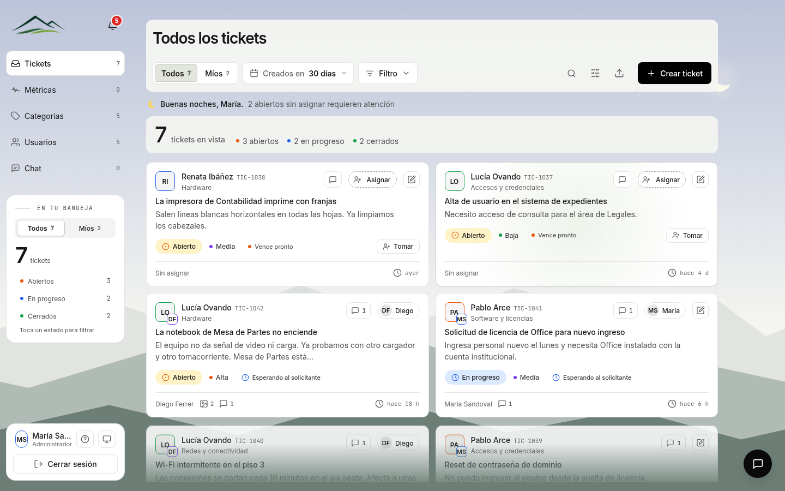
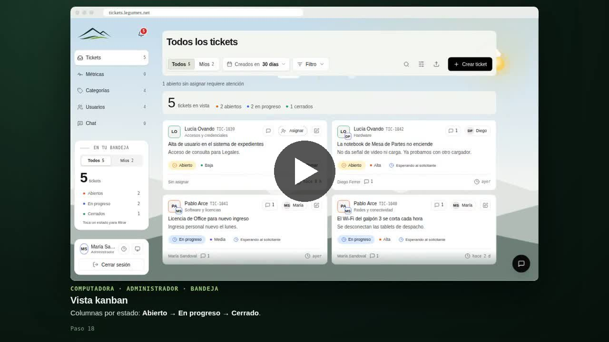
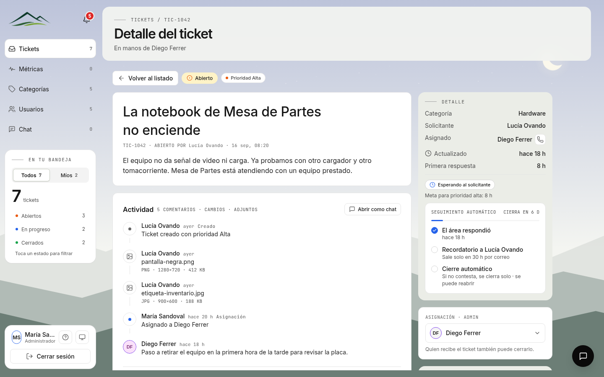
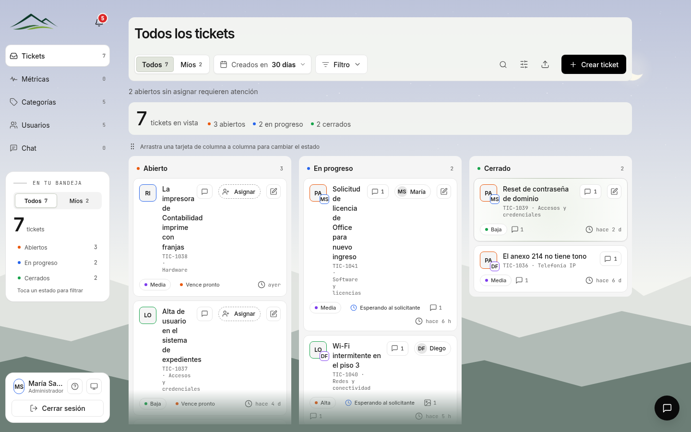
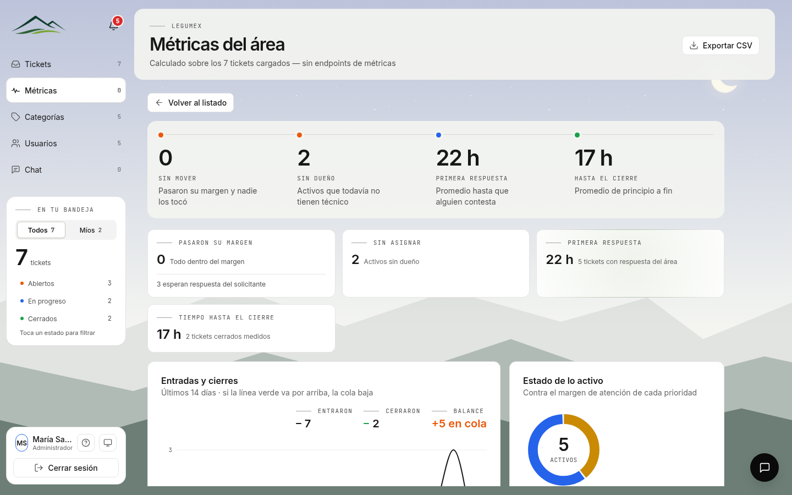
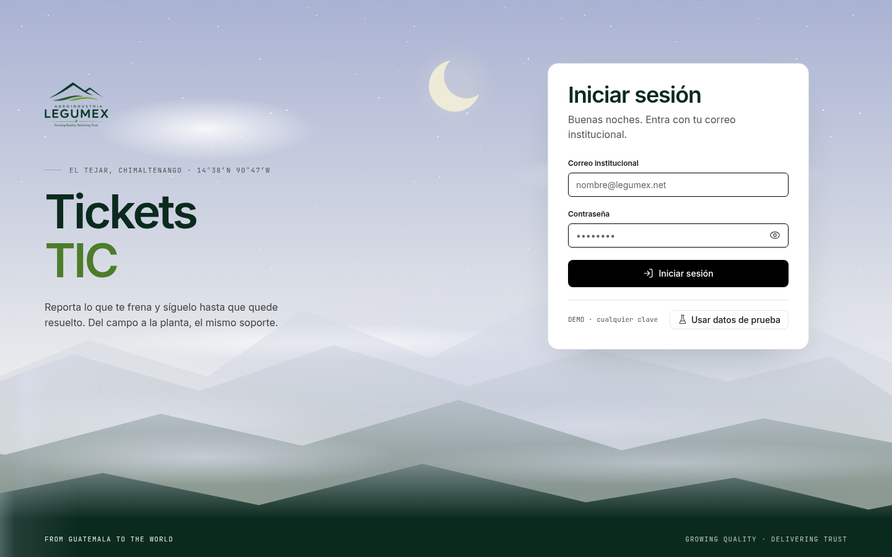
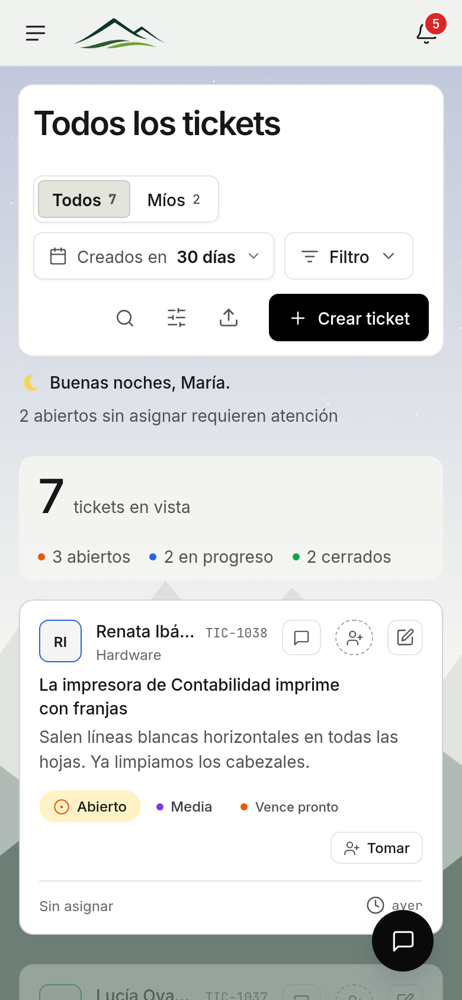

# Tickets TIC · Mesa de ayuda del área de TIC

Sistema interno para que el personal de Agroindustria Legumex reporte fallas técnicas al área de TIC y les dé seguimiento hasta que queden resueltas.

**🔗 Live demo:** https://tickets-tic-demo.vercel.app

> **Datos de demostración.** La demo funciona sin servidor y con datos inventados. No contiene información real de la empresa.



## Video

Recorrido de poco más de un minuto por las funciones principales (inicio de sesión, bandeja, kanban, creación de tickets, chat y vista en el teléfono), con datos de demostración.

[](docs/video/tickets-tic-recorrido.mp4)

▶️ [Ver el video (MP4)](docs/video/tickets-tic-recorrido.mp4)

## Qué problema resuelve

Tickets TIC es un canal interno para reportar fallas técnicas: cada persona abre un ticket, el equipo de TIC lo toma, conversa con quien lo reportó y lo cierra cuando queda resuelto. Así queda a la vista qué está pendiente, quién lo atiende y cuánto tarda.

El sistema se presentó al jefe del área de TIC.

## Funcionalidades

- **Tickets** por categoría (hardware, software y licencias, redes, accesos y credenciales), con prioridad y estado: abierto, en progreso o cerrado.
- **Tres vistas** de la lista: tarjetas, tabla y kanban (en kanban se arrastra una tarjeta para cambiar su estado), con búsqueda, filtros y orden por urgencia.
- **Detalle del ticket** con historial de actividad, comentarios, imágenes adjuntas y asignación a un técnico.
- **Chat por ticket** y notificaciones.
- **Métricas del área**: tickets sin dueño, tiempo hasta la primera respuesta, tiempo hasta el cierre, entradas contra cierres, y exportación a CSV.
- **Catálogos** de categorías y usuarios.
- **Dos roles:** administrador (equipo de TIC: ve todo, asigna, cambia estado y prioridad) y usuario (ve sus propios tickets, los crea y comenta).
- Diseño adaptado a computadora y a teléfono.

## Capturas

| Detalle del ticket | Vista kanban |
|---|---|
|  |  |

| Métricas del área | Inicio de sesión |
|---|---|
|  |  |

<p align="center"></p>

## Cómo entrar a la demo

1. Abre la [demo](https://tickets-tic-demo.vercel.app).
2. Pulsa **"Usar datos de prueba"** y luego **"Iniciar sesión"**.

En modo demostración se acepta cualquier contraseña. Usuarios de ejemplo (todos inventados):

| Rol | Correo |
|---|---|
| Administrador | `m.sandoval@legumex.net` |
| Usuario | `l.ovando@legumex.net` |

Los cambios que hagas en la demo viven solo en tu navegador y se reinician al recargar.

## Stack

- **Frontend (este repositorio):** React 18 y Vite 5, en JSX. Sin librerías de UI ni framework de CSS: estilos propios con variables globales en `src/index.css`.
- **Backend:** API REST en Laravel con autenticación JWT (repositorio aparte).
- **Arquitectura:** la lógica y el estado viven en `src/logic/`, la interfaz solo pinta lo que la lógica le entrega, y `src/services/sync.js` envía al servidor únicamente lo que cambió.

## Cómo correrlo en local

Requisitos: Node.js 18 o superior.

```bash
npm install

# Demo sin backend (datos de ejemplo en memoria)
VITE_DEMO=true npm run dev

# API simulada en el navegador, sin backend
npm run dev:simulado

# Contra la API real
cp .env.example .env   # ajusta VITE_API_URL y VITE_API_TARGET
npm run dev
```

Para generar la versión de producción: `npm run build` (sale en `dist/`).

## Mi rol

Participé como desarrollador en mi práctica profesional en el área de TIC de Agroindustria Legumex (agosto a septiembre de 2026).

## Más documentación

- [`CONTEXTO_SISTEMA_DISENO_REGLAS.md`](CONTEXTO_SISTEMA_DISENO_REGLAS.md): arquitectura, datos de prueba, API y reglas de diseño.
